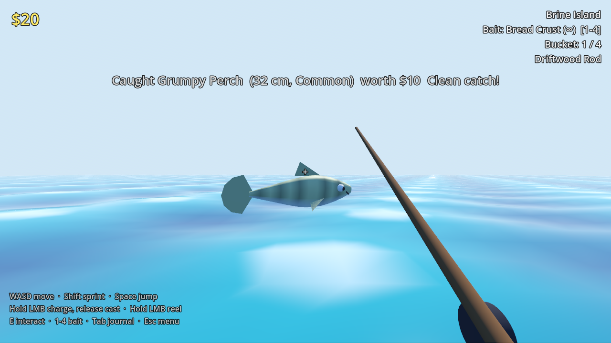
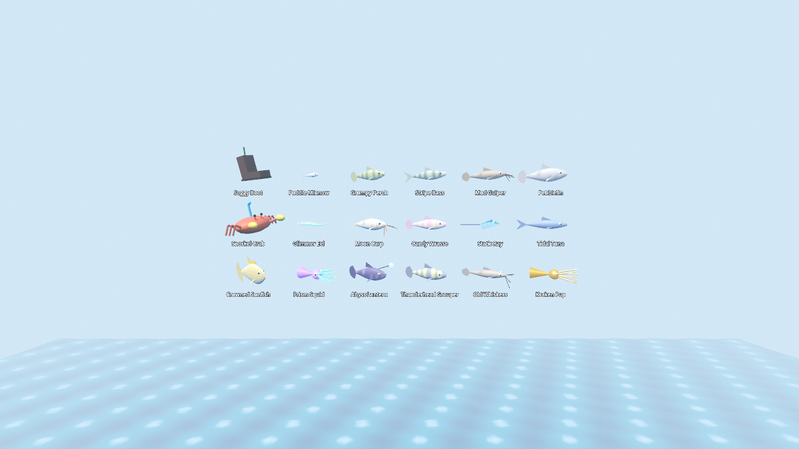
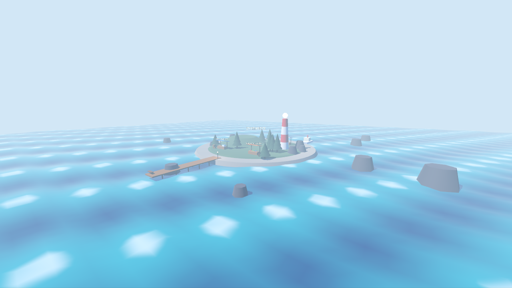
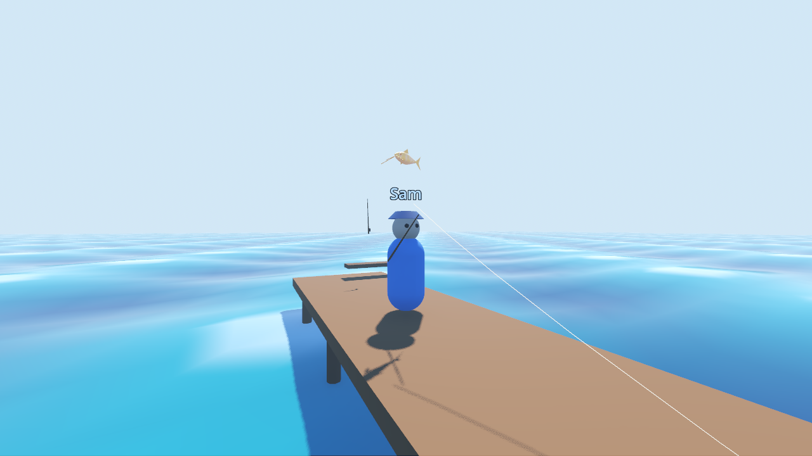
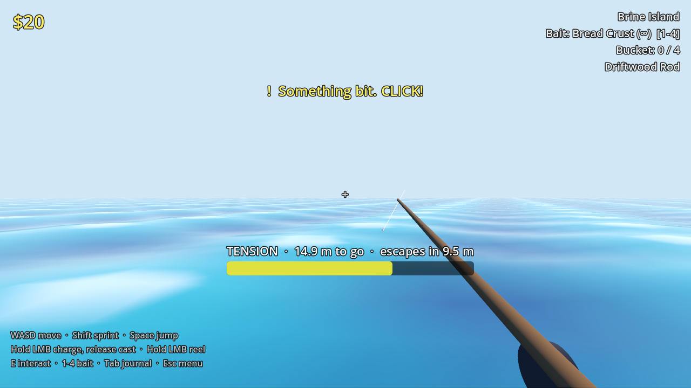

# Brine Time 🎣

A cozy, low-poly **co-op fishing game** made with **Godot 4.4**. Cast off the dock, win tense tug-of-war fights, sell your catch, upgrade your gear, and sail between three islands. You can play alone or with friends.



| | |
|---|---|
|  |  |
|  |  |

**Features**
- **Fishing:** charge a cast, react to the bite, then fight the fish on a tension meter (reel too hard and the line snaps, too soft and it escapes).
- **Creatures:** 18 of them, each with its own procedurally built 3D model, size roll, rarity and golden variant.
- **Islands:** 3 of them (Brine Island, Coral Key, Stormrock), each with its own store stock and island-only fish, connected by ferry.
- **Progression:** 4 bait tiers, 4 rods and 3 storage sizes, plus a Field Journal to complete.
- **Co-op:** up to 8 players over the network. You see each other fishing, with name tags and catch announcements.
- **Sound:** every sound is synthesized in code, so there are no audio files.
- **Art:** everything (world, UI, fish) is generated from GDScript. There are no binary scenes or assets to merge.

---

## 1. What you need to install

| What | Version | Where |
|---|---|---|
| **Godot Engine (Standard)** | **4.4.1** (any 4.4.x works) | https://godotengine.org/download/archive/4.4.1-stable/ |
| Git (to clone and contribute) | any recent | https://git-scm.com/downloads |

- **Pick Standard, not .NET.** The game is pure GDScript, and the .NET build adds requirements you don't need.
- **No installer needed.** Godot is a single executable: unzip it anywhere and run it.
  - **Windows:** the zip contains `Godot_v4.4.1-stable_win64.exe` and `Godot_v4.4.1-stable_win64_console.exe`. The console one is what the test scripts use.
  - **macOS:** `Godot.app` (right-click, then Open the first time to get past Gatekeeper).
  - **Linux:** `Godot_v4.4.1-stable_linux.x86_64` (run `chmod +x` on it).
- **Graphics:** a GPU with **Vulkan** support (most cards from 2016 onwards). If yours doesn't have it, see [Troubleshooting](#7-troubleshooting).
- Nothing else is required: no SDKs, plugins, packages or asset downloads.

## 2. Get the project

```bash
git clone https://github.com/mahiralmuntaqim/Guti.git
cd Guti
```

You can also click **Code, then Download ZIP** on GitHub and unzip it.

## 3. Run the game

**Option A: Godot Project Manager (works everywhere)**
1. Start Godot 4.4.
2. Click **Import**, browse to the cloned folder and select `project.godot`.
3. Click **Import & Edit**. The first import takes a few seconds.
4. Press **F5** (or the ▶ button at the top right) to play.

**Option B: double-click (Windows)**
- Run `play.bat`. It finds Godot through, in order:
  1. a `GODOT` environment variable pointing at `Godot_v4.4.1-stable_win64.exe`
  2. `godot` on your PATH
  3. a portable copy at `..\tools\godot\`

**Option C: command line (any OS)**
```bash
godot --path /path/to/Guti            # play
godot --path /path/to/Guti --editor   # open in the editor
```

## 4. How to play

### Controls
| Action | Input |
|---|---|
| Move / sprint / jump | WASD / Shift / Space |
| Charge and cast | Hold left mouse, release |
| Reel the bobber back | Hold left mouse while waiting |
| Hook a bite | Click when **"Something bit"** appears (~1 s window) |
| Fight | Reel in **bursts**. Holding raises tension (snaps at 100%); letting go lets the fish swim off |
| Use Market / Store / Ferry | Look at the counter and press **E** |
| Switch bait | 1 to 4 |
| Field Journal | Tab |
| Menu (resume, leave, quit, host address) | Esc |

### The loop
1. Fish off the dock. Your bait decides which creatures can bite.
2. Your **Bucket** holds 4 catches. Sell them at the **Fish Market**.
3. Spend the money at the **General Store** on bait, rods (faster reel and tougher line, needed for strong fish) and storage.
4. Value = base worth × size. **Golden** catches (4%) are worth ×3. Landing a fish without the tension going red is a **Clean catch**, worth +20%.
5. Unlock new islands at the **Ferry**:

| Island | Unlock | Store sells | Island-only catches |
|---|---|---|---|
| Brine Island | start | Worm, Glowberry, Bamboo Rod, Cooler | none |
| Coral Key | 5 species + $250 ticket | + Carbon Rod, Ice Chest | Candy Wrasse, Prism Squid |
| Stormrock | 10 species + $1500 ticket | + Thunder Spoon bait, Storm Rod | Thunderhead Grouper, Kraken Pup, more Old Whiskers |

Progress saves automatically after each catch, sale or purchase:

| OS | Save folder |
|---|---|
| Windows | `%APPDATA%\Godot\app_userdata\Brine Time\` |
| macOS | `~/Library/Application Support/Godot/app_userdata/Brine Time/` |
| Linux | `~/.local/share/godot/app_userdata/Brine Time/` |

Delete `brinetime_save.json` there to start over.

## 5. Playing together (co-op)

Each player keeps **their own** money, gear and catches. They're saved on their own computer and follow them between sessions. In a co-op session everyone shares the ocean: you see each other's avatars, casts and lines, and every catch, sale and ferry trip shows up in the feed.

**Everyone must run the same version of the game** (the same Git commit or download).

### Same Wi-Fi / LAN
1. **Host:** on the title screen, enter a name and click **Host Co-op**. The feed (and the Esc menu) shows your local IP, e.g. `192.168.1.20`.
2. If Windows asks whether Godot may use the network, click **Allow** (at least *Private networks*).
3. **Friends:** enter a name, type the host's IP and click **Join**.

### Over the internet
The game uses **UDP port 24680**. Pick one of these:
- **A virtual LAN (easiest):** everyone installs the same tool, such as [Tailscale](https://tailscale.com/), [ZeroTier](https://www.zerotier.com/) or [Radmin VPN](https://www.radmin-vpn.com/), and joins the same network. Then use the host's address from that tool (for example Tailscale's `100.x.y.z`) as above.
- **Port forwarding:** the host forwards **UDP 24680** on their router to their PC, then shares their public IP (search "what is my IP"). Friends join with that IP.

## 6. For collaborators

### Project layout
```
project.godot          engine config, autoloads (Data, Game, Sfx, Net)
main.tscn              the only scene; it just runs scripts/main.gd
scripts/
  main.gd              entry point: builds world, player, HUD, menu; co-op presence + event handling
  data.gd              ALL content and balance: creatures (+ model shapes), baits, rods, coolers, islands
  game_state.gd        player progress: money, inventory, journal, islands, buying/selling, save/load
  world.gd             builds every island from Data.ISLANDS (terrain, dock, stalls, theme props)
  player.gd            first-person controller, interaction, footsteps, bait hotkeys
  fishing.gd           rod state machine: charge, cast, wait, bite, tension fight, catch
  bobber.gd            floating bobber physics
  water.gd             wave shader + matching CPU wave-height function
  fish_model.gd        procedural low-poly creature meshes (fish/eel/ray/crab/squid/boot)
  sfx.gd               procedural sound synthesis + playback pools
  net.gd               ENet co-op: host/join, player registry, presence + event RPCs
  avatar.gd            how other players appear (body, name tag, rod, bobber, line)
  hud.gd               all UI: status, toasts, co-op feed, meters, Store/Journal/Ferry/Pause panels
  menu.gd              title screen (name, Solo / Host / Join)
  stall.gd             Market / Store / Ferry counters
  bob.gd               makes decorative objects bob on the waves
  tests.gd             automated smoke tests
docs/screenshots/      images used by this README
DESIGN_NOTES.md        design pillars, system notes, roadmap
```

**The whole game is built in code.** There's one tiny `.tscn` file; the world, UI and meshes are created by scripts. This keeps merges painless, since everything is plain-text GDScript. Please keep it that way unless the team agrees otherwise.

### Common changes
- **Rebalance:** edit numbers in `scripts/data.gd`.
  - creature `worth` / `strength`
  - bait `table` weights, `bite` times, `consume` chance
  - rod `reel` / `line`
  - island `cost` / `species` / store limits
- **Fight feel:** the constants at the top of `scripts/fishing.gd` (`FISH_PULL`, `HELD_PULL`, `TENSION_GAIN`, `TENSION_RELAX`).
- **Add a creature:**
  1. Add an entry to `CREATURES` in `data.gd`, including a `model` dict. Shapes are `fish`, `eel`, `ray`, `crab`, `squid` and `boot`; extras are `whiskers`, `crown`, `lure`, `glow`, `snorkel` and `frown`.
  2. Add it to a bait `table` or an island's `exclusive` table.
  3. Run `--smoke-gallery` (below) to see the model.
- **Add an island:** append to `ISLANDS` in `data.gd` with a new `origin` far from the others, and a `theme` (`palm`, `coral` or `storm`, or add a new case in `world.gd`). The ferry, store and spawn work automatically.
- **Add a sound:** write a generator in `sfx.gd`, register it in `_streams`, then call `Sfx.play("name")` or `Sfx.play_at("name", position)`.
- **New networked event:** call `Net.send_event("kind", {...})` where it happens, then handle `"kind"` in `main.gd` `_on_event`. Use only plain data: numbers, strings, bools, vectors and dictionaries.

### Code style
- GDScript with static typing (`var x: int`, `:=`, typed function signatures) and tabs for indentation.
- Typing matters for dictionary values: `var s := dict["k"]` fails to infer a type, so use `var s: float = dict["k"]`.
- Keep content (numbers, names) in `data.gd` and logic in the system scripts.
- No warnings or errors in the Godot output panel.

### Run the tests before pushing
The smoke tests drive the real game: they cast, fight, sell, buy, travel, build every model, and run a host and a client against each other on `127.0.0.1`.

**Windows:**
```bat
set GODOT_CONSOLE=C:\path\to\Godot_v4.4.1-stable_win64_console.exe
run_tests.bat
```

**macOS, Linux or Git Bash:**
```bash
GODOT=/path/to/godot ./run_tests.sh
```

The run should end with **`ALL TESTS PASSED`**. To run a single test:
```bash
godot --headless --path . --fixed-fps 60 -- --smoke            # core loop
godot --headless --path . --fixed-fps 60 -- --smoke-islands    # ferry, island tables, models, sounds
godot --headless --path . -- --smoke-host                      # terminal 1
godot --headless --path . -- --smoke-join=127.0.0.1            # terminal 2
godot --path . -- --smoke-gallery --shots=/some/folder         # screenshots of every creature + island (needs a window)
```

### Git workflow
1. `git pull` on `main`, then branch: `git checkout -b feature/short-description`.
2. Make your change, play it (F5), and run the tests.
3. Commit with a clear message, push, and open a Pull Request into `main`.
4. Don't commit the `.godot/` folder. It's local editor cache and is already in `.gitignore`. Do commit the `*.gd.uid` files Godot creates next to scripts.

### Exporting a build to share
In the editor go to **Project, then Export**. The first time, Godot offers to download the 4.4.1 export templates; accept. Add a Windows, macOS or Linux preset and click **Export Project**. Friends can then play without installing Godot.

## 7. Troubleshooting

| Problem | Fix |
|---|---|
| Godot says the project is for a newer/older version | Use Godot **4.4.x**. 4.3 and older won't open it. Newer 4.x versions usually upgrade it, but don't commit an upgraded project without agreeing on it |
| Black window or "Vulkan" error on start | Your GPU lacks Vulkan. Run `godot --path . --rendering-driver opengl3`, or in the editor go to **Project, then Project Settings, then Rendering, then Renderer** and set it to **Compatibility** (don't commit that change) |
| Can't join a friend | Check the IP, make sure the host clicked **Host Co-op**, allow Godot through the Windows firewall, and over the internet use a virtual LAN or forward UDP 24680 |
| "Couldn't host on port 24680" | Another copy of the game is already hosting on this PC. Close it |
| Mouse is stuck or free | Click in the game window to recapture it. Esc opens the menu |
| Want a fresh start | Delete the save file (see the save folders in section 4) |

## Credits
Made with [Godot Engine](https://godotengine.org) (MIT licensed). All code, models and sounds in this repository are original and generated procedurally.
